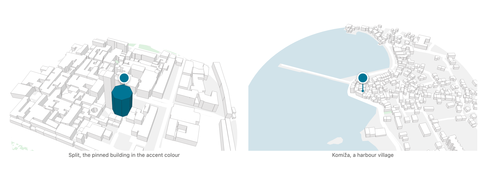

# birdseye

A bird's-eye picture of the streets around a map pin: the buildings raised
from their OpenStreetMap footprints and seen from above at an angle, over
the parks, water and roads, as one small SVG a web page colours with its
own theme. The building under the pin is drawn in the accent colour.

<picture>
  <source media="(prefers-color-scheme: dark)" srcset="docs/birdseye-dark.png">
  
</picture>

Each picture is one SVG of 40 to 330 KB and takes milliseconds to draw. The
colours come from the page's CSS, so the same file follows light and dark
mode (switch GitHub's theme to see the other one), and the marker is the
page's own HTML at a fixed point. `scripts/screenshot.sh` redraws these.

```go
archive, err := pmtiles.Open("croatia-z14.pmtiles")
// ...
pic, err := birdseye.Render(archive, birdseye.Pin{Lat: 45.0827, Lng: 13.6312})
switch {
case errors.Is(err, birdseye.ErrNoTiles), errors.Is(err, birdseye.ErrTooSparse):
	// no picture worth showing here: show an ordinary map
case err != nil:
	// a read error
}
// pic.SVG: about 40 to 330 KB, 8 to 56 KB gzipped; 1 to 16 ms to draw
```

On the page:

```html
<link rel="stylesheet" href="birdseye.css">   <!-- birdseye.Stylesheet -->
<div class="birdseye" style="position: relative">
  <svg viewBox="0 0 1600 1000"><use href="/where/you/serve/pic.svg#s"/></svg>
  <span style="position: absolute; left: 50%; top: 58%">your marker</span>  <!-- PinX, PinY -->
</div>
```

The picture is a pure function of the tiles, the pin and `StyleVersion`, so
nothing needs storing: draw on the first view and keep the bytes in memory,
keyed by the pin, and use a hash of the SVG as the address's version. The
package documentation (`go doc github.com/mirsafari/birdseye`) lists what
a page can rely on: the group id, the 14 CSS colour variables, where the
pin lands, and when there is no picture.

## Packages

| Package | What |
| --- | --- |
| `birdseye` | `Render`, `RenderWith`, `Tiles`, `DirTiles`, `FSTiles`, `TilesFor`, `Stylesheet`, `Colors`. Standard library only. |
| `birdseye/pmtiles` | Reads a PMTiles v3 archive from any `io.ReaderAt`: `Open(path)` for a file, `New(strings.NewReader(embedded))` for an archive in the binary. Standard library only. |
| `birdseye/birdseyetest` | Fixtures for tests, birdseye's and an app's: the tiles around eleven places in Croatia (embedded, about 700 KB) and the places. |
| `cmd/birdseye` | The dev tool: `one` draws a pin, `sheet` draws every fixture place into a page to judge the look, `cut` refreshes the fixtures from an archive. |

## The tiles

`Render` reads zoom-14 vector tiles in the OpenMapTiles schema. Each release
carries `croatia-z14.pmtiles` (about 90 MB) and its `.sha256`, built by the
release workflow with `scripts/build-tiles.sh`, which runs Planetiler in
Docker over Geofabrik's extract with only the seven layers birdseye reads.
Another country is `scripts/build-tiles.sh <geofabrik-area>`.

An app downloads the archive when it builds its image, checks the sum, and
either ships it next to the binary (its own image layer, so a deploy that
changes only code does not upload it again) or embeds it:

```go
//go:embed croatia-z14.pmtiles
var archive string // read-only data, paged in as tiles are read

tiles, err := pmtiles.New(strings.NewReader(archive))
```

The download needs no account:

```sh
curl -fLO https://github.com/mirsafari/birdseye/releases/download/vX.Y.Z/croatia-z14.pmtiles
curl -fLO https://github.com/mirsafari/birdseye/releases/download/vX.Y.Z/croatia-z14.pmtiles.sha256
shasum -a 256 -c croatia-z14.pmtiles.sha256
```

## Developing

```sh
go test ./...
go run ./cmd/birdseye sheet -serve :8099          # the fixtures, light or dark with the system
go run ./cmd/birdseye sheet -tiles dist/croatia-z14.pmtiles -serve :8099
scripts/build-tiles.sh                             # dist/croatia-z14.pmtiles
BIRDSEYE_PMTILES=$PWD/dist/croatia-z14.pmtiles go test ./pmtiles   # the reader against Planetiler's archive (an absolute path: the test runs in pmtiles/)
```

A change to what the same tiles and pin draw bumps `StyleVersion`. The
render tests pin building counts per fixture place; they move when the
fixtures are cut again from a newer archive (`birdseye cut`).

## Licences

The code is MIT (`LICENSE`). The tiles are not: the fixtures in
`birdseyetest/fixtures/tiles` and the archives on the releases are produced
from OpenStreetMap data, © OpenStreetMap contributors, and made available
under the [Open Database License](https://opendatacommons.org/licenses/odbl/1-0/)
([openstreetmap.org/copyright](https://www.openstreetmap.org/copyright)), in
the [OpenMapTiles](https://openmaptiles.org/) schema (CC-BY 4.0). A page
showing a picture credits **© OpenMapTiles © OpenStreetMap contributors**.
